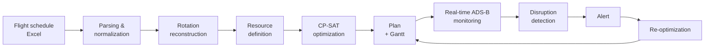

# ✈️ Aircraft Stand Assignment & Real-Time Tracking

🇬🇧 English | [🇫🇷 Français](README.fr.md)

**Decision-support system for Tanger Ibn Battouta Airport (ONDA)**

Built during an internship at ONDA (Office National Des Aéroports, Morocco's national airports authority), from 01/07/2026 to 01/09/2026, within the PCO, CCO and SOA departments.

  

---

## 🎯 Problem

Every week, the flight schedule has to be turned into a plan assigning each aircraft to a parking stand. The plan must respect aircraft/stand compatibility, avoid overlaps and keep a safety margin, and must be re-planned as soon as a delay disrupts the schedule.

## 💡 Solution

A pipeline that reads the flight schedule (Excel), computes an optimal plan with a constraint-programming solver, displays it as a Gantt chart, then monitors flights in real time to detect disruptions and re-optimize.

> **A decision-support system, not a replacement**: the PCO operator remains the only operational decision-maker. The system proposes, the human validates.

## 🔄 Pipeline



## 🧮 Optimization model

**Resources**: 15 stands — `N8, N7, N6, N5, N4, N3, N2, N1, E7, E6, E5, E4, E3, E2, E1`

**Hard constraints**
- Aircraft / stand compatibility
- No time overlap on the same stand
- 60-minute buffer between two occupations
- Push-back adjacency respected

**Preferences (soft constraints)**
- Proximity to gates
- Preference for N8 on quick turnarounds
- Penalty when overflowing to ECO stands

## 📊 Results

Tested on a real flight schedule (week 32, 03–09 August 2026).

| Indicator | Result |
|---|---|
| Flights extracted from the schedule | 276, no row skipped |
| Successful assignments over the week | **327 / 329 (99.39 %)** |
| Day of 04/08/2026 | 47 / 47 flights assigned, solver status **OPTIMAL** |
| +40 min delay scenario on one flight | Automatic reassignment, **0 conflicts** left |

## 🖥️ Interface (Flask, local)

- Date selection
- Daily and weekly Gantt charts
- Operations table and assignment list
- Alerts and real-time monitoring status

## 🛠️ Tech stack

| Area | Technologies |
|---|---|
| Optimization | Python, Google OR-Tools (CP-SAT) |
| Data | Excel parser, SQLAlchemy |
| Real time | OpenSky Network (primary source), airplanes.live (fallback), ADS-B data |
| Interface | Flask, Plotly |

## 📁 Structure

```
onda-stand-assignment/
└── tanger_pco_gantt/
    ├── src/               # Source code (parser, optimizer, real-time, Flask UI)
    ├── requirements.txt
    ├── .env.example       # API key configuration template
    ├── etude_comparative_APIs.md
    └── APIs_validation_encadrant.md
```

Module details: [`tanger_pco_gantt/README.md`](tanger_pco_gantt/README.md).

## 🚀 Installation & run

```bash
git clone https://github.com/ayakhama3/onda-stand-assignment.git
cd onda-stand-assignment/tanger_pco_gantt

python -m venv venv
venv\Scripts\activate          # Linux/macOS: source venv/bin/activate
pip install -r requirements.txt

cd src
python app.py "path/to/schedule.xlsx" 04/08/2026
```

Then open `http://127.0.0.1:5000` in your browser. The second argument (date, `DD/MM/YYYY`) is optional.

### Real-time tracking configuration

Copy `tanger_pco_gantt/.env.example` to `tanger_pco_gantt/.env` and fill in your own keys (OpenSky Network, and AviationStack as an option). The `.env` file is git-ignored.

### Data

For confidentiality reasons, **the airport's real flight schedule is not published**, nor are the Gantt charts generated from it. To run the application, provide an Excel file in the same format as the airport's operational schedule.

## ⚠️ Known limitations

- No direct write access to SOAM / ivMS-4200
- ADS-B data does not replace the operational schedule
- Gates, counters and baggage belts are not optimized simultaneously
- The system remains a decision-support tool

## 🔭 Roadmap

- Joint optimization of stands, gates and counters
- Server deployment with containerization (Docker)
- Automated tests and continuous integration
- Fictitious sample file and anonymized screenshots of the interface

## 👩‍💻 Author

**Aya Khama** — Data Science & AI engineering student (EMSI, class of 2027)
[LinkedIn](https://www.linkedin.com/in/aya-khama-160752387/) · [GitHub](https://github.com/ayakhama3)
