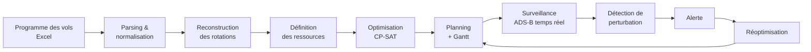

# ✈️ Affectation des postes de stationnement avions & suivi temps réel

**Système d'aide à la décision pour l'aéroport Tanger Ibn Battouta (ONDA)**

Projet réalisé lors d'un stage à l'ONDA (Office National Des Aéroports), du 01/07/2026 au 01/09/2026, au sein des services PCO, CCO et SOA.

  

<!-- Ajoute ici une capture d'écran du Gantt :  -->

---

## 🎯 Problème

Chaque semaine, le programme des vols doit être transformé en un planning d'affectation des avions aux postes de stationnement (stands). Il faut respecter la compatibilité avion/poste, éviter les chevauchements et garder une marge de sécurité, puis replanifier dès qu'un retard perturbe le programme.

## 💡 Solution

Un pipeline qui lit le programme des vols (Excel), calcule un planning optimal avec un solveur de programmation par contraintes, l'affiche sous forme de Gantt, puis surveille les vols en temps réel pour détecter les perturbations et réoptimiser.

> **Système d'aide à la décision, pas de remplacement** : l'agent PCO reste l'unique décideur opérationnel. Le système propose, l'humain valide.

## 🔄 Pipeline



## 🧮 Modèle d'optimisation

**Ressources** : 15 postes — `N8, N7, N6, N5, N4, N3, N2, N1, E7, E6, E5, E4, E3, E2, E1`

**Contraintes dures**
- Compatibilité entre l'avion et le poste
- Aucun chevauchement horaire sur un même poste
- Marge de 60 minutes entre deux occupations
- Adjacence push-back respectée

**Préférences (contraintes souples)**
- Proximité des portes
- Préférence pour N8 lors des rotations rapides
- Pénalité en cas de débordement vers les postes ECO

## 📊 Résultats

Testé sur un programme de vols réel (semaine S32, du 03 au 09 août 2026).

| Indicateur | Résultat |
|---|---|
| Vols extraits du programme | 276, aucune ligne ignorée |
| Affectations réussies sur la semaine | **327 / 329 (99,39 %)** |
| Journée du 04/08/2026 | 47 / 47 vols affectés, solveur au statut **OPTIMAL** |
| Scénario de retard de +40 min sur un vol | Réaffectation automatique, **0 conflit** restant |

## 🖥️ Interface (Flask, en local)

- Sélection de la date
- Gantt journalier et hebdomadaire
- Tableau opérationnel et liste des affectations
- Alertes et état de la surveillance temps réel

## 🛠️ Stack technique

| Domaine | Technologies |
|---|---|
| Optimisation | Python, Google OR-Tools (CP-SAT) |
| Données | Parseur Excel, SQLAlchemy |
| Temps réel | OpenSky Network (source principale), airplanes.live (secours), données ADS-B |
| Interface | Flask |

## 🚀 Installation

```bash
git clone https://github.com/ayakhama3/onda-stand-assignment.git
cd onda-stand-assignment

python -m venv venv
venv\Scripts\activate          # Linux/Mac : source venv/bin/activate
pip install -r requirements.txt

python <fichier_de_lancement>.py   # À ADAPTER : le fichier qui démarre l'application Flask
```

Ouvre ensuite l'adresse affichée dans le terminal (généralement `http://127.0.0.1:5000`).

### Données

Pour des raisons de confidentialité, **le programme réel des vols de l'aéroport n'est pas publié**. Place un fichier au même format dans le dossier `data/` (un exemple fictif est fourni : `data/exemple_programme.xlsx`).

<!-- À faire : créer un petit fichier Excel fictif avec la même structure de colonnes -->

## ⚠️ Limites connues

- Pas d'écriture directe dans SOAM / ivMS-4200
- Les données ADS-B ne remplacent pas le programme opérationnel
- Les portes, comptoirs et tapis ne sont pas optimisés simultanément
- Le système reste une aide à la décision

## 🔭 Pistes d'amélioration

- Optimisation conjointe des postes, portes et comptoirs
- Déploiement sur un serveur avec conteneurisation (Docker)
- Tests automatisés et intégration continue

## 👩‍💻 Auteure

**Aya Khama** — Élève ingénieure Data Science & IA (EMSI, promotion 2027)
[LinkedIn](https://www.linkedin.com/in/aya-khama-160752387/) · [GitHub](https://github.com/ayakhama3)
